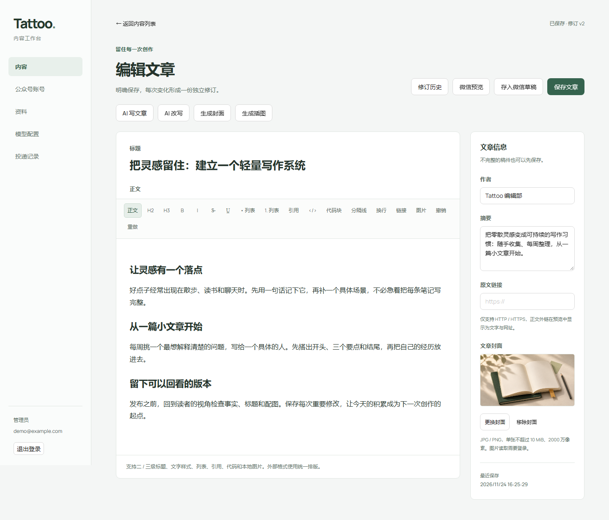
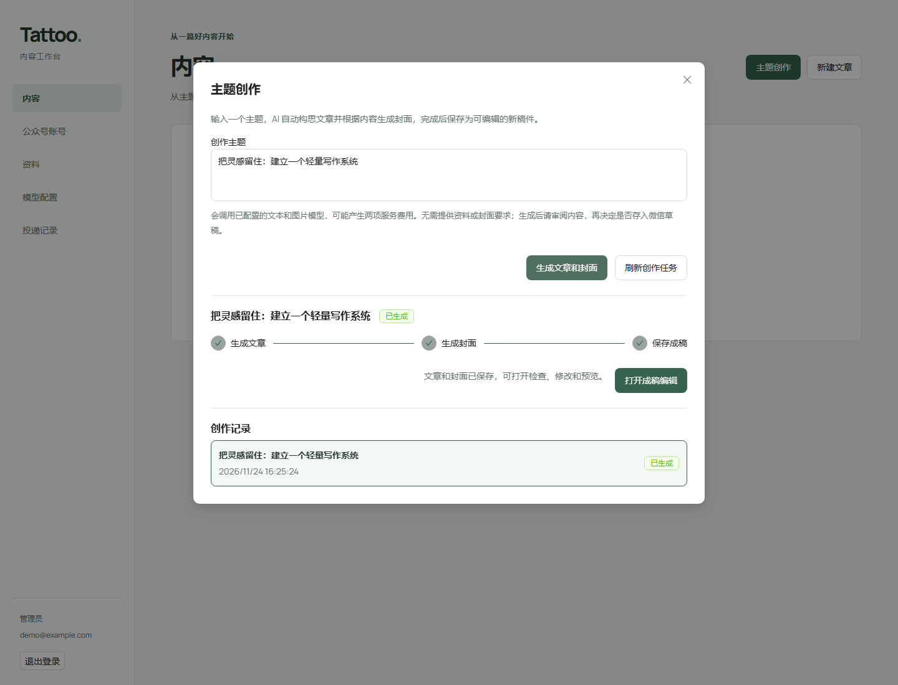

<div align="center">

# Tattoo

**把一个主题，变成一篇有封面的文章。**

为个人与 NAS 自托管准备的内容工作台。收集资料、AI 创作、编辑修订，再把确认后的文章存入微信公众号草稿。

[](https://github.com/brucewar/tattoo/actions/workflows/ci.yml)
[](docs/RELEASE-NOTES.md)
[](docs/DEPLOYMENT.md)
[](LICENSE)

[快速部署](#快速部署) · [开始使用](docs/GETTING-STARTED.md) · [文档](docs/README.md) · [常见问题](docs/FAQ.md) · [反馈问题](https://github.com/brucewar/tattoo/issues/new/choose)

</div>



<p align="center"><sub>真实界面，使用演示数据与本地模拟模型响应；封面为 AI 生成示例。截图不代表真实模型效果或第三方接口验收。</sub></p>

## 从灵感到草稿

**输入主题 → 生成文章与封面 → 编辑、保存与预览 → 确认后存入微信草稿。**

你也可以先手写，或收集资料后再创作。文章、图片和修订保存在自己的实例中；模型服务和公众号按需配置。

| 能力       | 现在可以做什么                                                                                   |
| ---------- | ------------------------------------------------------------------------------------------------ |
| 主题创作   | 只输入一个主题，后台生成文章与封面，自动保存为可编辑的新稿；刷新页面后可找回任务                 |
| 写作与修订 | 富文本编辑、图片上传、明确保存为独立修订、查看历史、微信排版预览                                 |
| AI 助手    | 写文章、改写、生成封面与插图；编辑器内的候选由你选择采用                                         |
| 模型配置   | 文本支持 Chat Completions、Responses、Anthropic Messages；图片使用独立的 Images Generations 接口 |
| 资料库     | 提取公开链接、手动拉取 RSS / Atom、通过 Tavily 按需搜索并选择采集，写作时引用已存资料            |
| 微信草稿   | 管理公众号账号，确认账号与文章修订后后台投递，查看记录与处理结果                                 |
| 自托管     | Docker Compose 部署，数据库与图片持久保存，提供备份、恢复和升级指引                              |

<details>
<summary>查看主题创作界面</summary>



截图使用演示数据；生成完成后，点击“打开成稿编辑”继续检查与修改。

</details>

## 快速部署

当前版本为 **`0.1.0-rc.1` 候选版**。建议先在局域网试用，按自己的服务配置验证模型和微信接口。

| 部署项     | 说明                                                                  |
| ---------- | --------------------------------------------------------------------- |
| 容器环境   | Docker Engine + Docker Compose v2，支持 Linux 容器及 `--wait` 参数    |
| 支持平台   | **`linux/amd64`（x86-64）**；当前没有 ARM 镜像                        |
| 应用镜像   | `ghcr.io/brucewar/tattoo:0.1.0-rc.1`，可匿名拉取                      |
| 运行容器   | API、Worker、PostgreSQL 共 3 个；API 与 Worker 共用同一个 Tattoo 镜像 |
| 访问与存储 | 默认端口 `8080`；数据库与图片分别使用持久卷                           |
| 主机依赖   | 运行服务无需安装 Node.js、npm 或下载源码                              |

以下命令在 **Linux / NAS 的 Docker 主机终端**执行。Windows 用户请使用[PowerShell 部署步骤](docs/DEPLOYMENT.md#1-下载-compose-并生成配置)。

### 1. 下载部署文件并生成配置

```bash
mkdir tattoo
cd tattoo
curl -fL https://raw.githubusercontent.com/brucewar/tattoo/v0.1.0-rc.1/compose.yaml -o compose.yaml
docker pull ghcr.io/brucewar/tattoo:0.1.0-rc.1
docker run --rm --user "$(id -u):$(id -g)" --mount "type=bind,source=$(pwd),target=/config" ghcr.io/brucewar/tattoo:0.1.0-rc.1 node scripts/configure.mjs --output /config/.env
```

生成器会创建随机管理员密码、数据库密码与加密主密钥，并拒绝覆盖已有 `.env`。

### 2. 调整访问地址

用编辑器打开 `.env`，核对以下配置：

```dotenv
# 改成浏览器实际访问的地址，例如 NAS 的局域网地址
APP_ORIGIN=http://192.168.1.20:8080
WEB_PORT=8080

# 首次登录使用的管理员邮箱；密码见已生成的 ADMIN_PASSWORD
ADMIN_EMAIL=you@example.com
```

将示例 IP 换成自己的地址；在 Docker 主机本机访问可保留 `http://localhost:8080`。请妥善保管 `.env`，并独立备份 `APP_ENCRYPTION_KEY`。升级时继续使用原密钥。

### 3. 启动服务

```bash
docker compose config --quiet
docker compose pull
docker compose up -d --no-build --remove-orphans --wait --wait-timeout 180
```

打开你设置的 `APP_ORIGIN`，用 `.env` 中的管理员邮箱和密码登录。完整步骤、反向代理、版本固定和升级说明见[部署指南](docs/DEPLOYMENT.md)。

## 写出第一篇文章

1. **直接开始**：进入“内容”→“新建文章”，手动编辑并保存。无需模型或公众号凭证。
2. **配置 AI**：进入“模型配置”，分别设置文本和图片模型的协议、地址、模型名与 API Key。
3. **输入主题**：进入“内容”→“主题创作”，填写主题，点击“生成文章和封面”。完成后打开成稿，检查内容并保存修改。
4. **按需投递**：先看“微信预览”；如需存入公众号，按[首次使用指南](docs/GETTING-STARTED.md#5-接入微信公众号)配置账号与远程写入，再确认投递。

主题创作会调用已配置的模型，可能产生服务费用。编辑器内的单项 AI 结果需明确采用；主题创作则自动保存一篇新稿。两种方式都由你决定何时投递微信。

资料获取和搜索不是主题创作的前置条件。想带着资料写作，可再看[资料库使用说明](docs/SOURCES.md)。

## 使用前了解

- **当前是候选版**：Docker 部署与本地模拟闭环已经验收；真实模型、Tavily 和目标微信公众号仍需在自己的环境验证。
- **微信支持官方草稿接口**：投递成功后到公众号后台检查，正式发表由你完成。返回结果不确定时先核对，避免重复投递。
- **知乎与小红书导出仍在计划中**；当前没有自动选题、周期生成、热点日报或多平台自动发表。
- **个人实例优先**：一个管理员，使用 PostgreSQL 持久任务表与单 Worker。NAS 不限品牌，当前仅发布 `linux/amd64` 镜像。

更多范围与变化见[版本说明](docs/RELEASE-NOTES.md)，遇到问题先看[常见问题](docs/FAQ.md)。

## 文档与支持

| 我想……                         | 从这里开始                                               |
| ------------------------------ | -------------------------------------------------------- |
| 在 NAS 或服务器安装            | [部署指南](docs/DEPLOYMENT.md)                           |
| 完成第一篇主题文章             | [开始使用](docs/GETTING-STARTED.md)                      |
| 接入文本、图片模型             | [模型与 AI 创作](docs/MODELS.md)                         |
| 使用链接、RSS 和搜索资料       | [资料获取](docs/SOURCES.md)                              |
| 升级、备份、恢复或迁移         | [运行维护](docs/OPERATIONS.md)                           |
| 页面打不开、忘记密码、任务失败 | [常见问题](docs/FAQ.md)                                  |
| 了解架构、开发和验收           | [文档首页](docs/README.md) · [贡献指南](CONTRIBUTING.md) |

发现缺陷或希望增加功能，请[提交 Issue](https://github.com/brucewar/tattoo/issues/new/choose)。报告安全问题请使用[安全报告渠道](SECURITY.md)，不要公开凭证、配置文件或文章数据。

Tattoo 使用 [MIT License](LICENSE)。欢迎改进文档、反馈使用体验和贡献代码。
