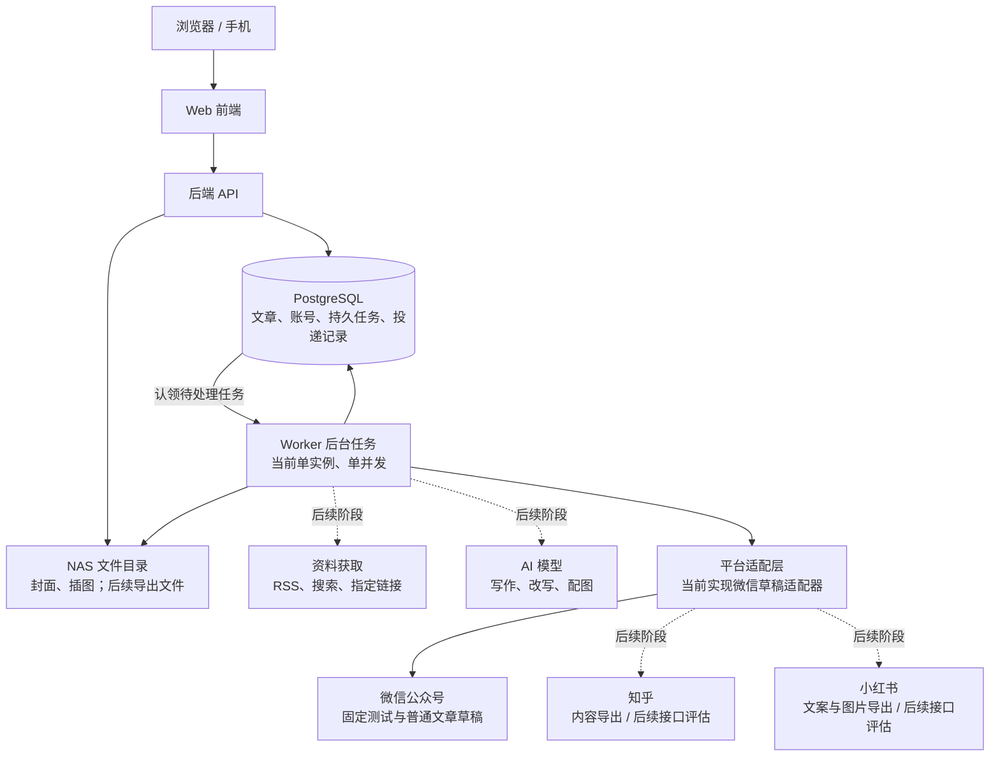

# Tattoo 技术架构与第一阶段设计

状态：Accepted；版本 0.3（2026-11-20），依据已确认的 [SPEC](SPEC.md)。本文区分完整产品目标、当前阶段设计与已完成实现。

## 整体架构与实施顺序

完整目标包括资料获取、AI 写作/改写/配图、微信公众号草稿，以及知乎和小红书的内容导出与后续接口接入。当前先完成普通文章到微信草稿箱的闭环，再开展资料获取与 AI；后续能力尚未实施。



实线表示已有实现链路，包含固定测试与普通文章草稿；虚线表示尚未实施的资料获取、AI 和导出规划。实现状态与验收结果分开记录，微信节点不代表真实公众号或目标 NAS 验收通过，详见 [P4 验证记录](P4-VERIFICATION.md)。

原始架构图中的 Redis/BullMQ 已经明确调整为 PostgreSQL 持久任务表，详见 [架构决策](adr/0001-postgresql-task-queue.md)。新增采集或 AI 不自动触发迁移；确有需求且现有方案不适合时，再评估队列系统，不设迁移日期。

## 1. 结构与依赖方向

```text
apps/web              React、Ant Design、Tiptap；只调用后端，不持有平台密钥
apps/server           NestJS HTTP 入口与 Worker 入口，共用业务模块
packages/contracts    Zod 输入、公开 DTO、平台能力与任务状态
docs                  规格、设计、计划、部署与运维说明
tests                 单元、集成、浏览器与微信模拟服务
scripts               环境配置、验证、备份辅助脚本
```

后端模块：Identity、Accounts、Content、Assets、Publishing、Platforms。HTTP 控制器只解析输入和调用用例；Worker 从数据库认领任务 ID，并调用 Publishing 用例。平台适配器不可依赖控制器、浏览器状态或任务扫描器。

```text
Web → HTTP controller → application use case → domain rules
                                           → repository / storage / platform interface
Worker → same application use case          → concrete adapters
```

先采用模块化单体，不拆微服务。API 与 Worker 为不同运行进程，共用镜像。共享 DTO 不包含 Prisma 实体和加密凭证。

后端的 Controller、Service 与模块装配已拆分为独立文件。Accounts、Assets、Content 分别由控制器转交业务服务，`*.module.ts` 负责依赖注入；健康检查也独立为控制器。当前业务服务通过 Database（Prisma）完成持久化，事务围绕具体用例组织。

PublishingService 负责投递预检、幂等提交、查询、显式重试和人工核对；PublishingExecutor 负责任务认领、恢复、素材准备、产物固化及远程执行。两者通过 `PLATFORM_DRAFT_ADAPTER` 注入 PlatformDraftAdapter，由 WechatModule 绑定 WechatService，不依赖具体微信错误类。账号只读诊断仍是微信账号用例，使用 WechatService。

通用正文结构、安全检查和素材引用提取位于 `content/document.ts`，公开文档契约在 `packages/contracts`。微信渲染、纯预检、字段/图片规则、URL 检查和 HTTP 错误转换位于 `platforms/wechat/`；Content 保存只执行通用规则，微信预览用例调用平台的纯渲染与检查，不发出远程请求。

后续资料获取和 AI 产物进入现有稿件、修订与素材流程，具体接口和任务模型在对应阶段设计。当前 Delivery 表示平台投递意图，不预先把采集、AI 和所有导出任务都塞进 Delivery，也不提前创建无实现的通用任务协议。

## 2. 重要模型

- Article：稿件身份、乐观锁版本与当前修订指针。
- Revision：不可变稿件快照，含标题、作者、摘要、来源链接、正文、封面及素材引用；有变化的保存才创建。
- Account：平台账号身份、加密凭证、凭证版本、验证来源和逐项能力。
- Asset：安全重编码后的本地素材；内容哈希去重。
- RemoteAsset：某账号对某素材、某用途的远程映射；封面与正文图不同用途。
- Delivery：账号 + 修订 + 动作的唯一投递意图，同时作为持久任务，保存平台标识、渲染版本、产物及平台结果。
- DeliveryAttempt / Event：执行阶段与人工核对轨迹。

第一阶段不建立 Variant、VariantRevision 或 OutboxEvent，不同时维护两套内容快照。第二个平台出现独立编辑需求时再迁移引入平台版本；通用 Revision 不含微信字段。正文引用与封面均建立可验证的 Asset 关联，历史引用素材不能删除。首次测试草稿创建明确标记的测试稿件/修订，使用同一投递链路。

## 3. 平台接口

当前阶段只实现微信模块和实际用例需要的薄接口：只读验证、纯渲染/校验、封面上传、正文图上传、新增草稿。Publishing 编排用例持有任务阶段，适配器不能在通用 HTTP 重试器中隐藏重试新增草稿。人工核对由 Publishing 记录，不预建无实现的通用 `reconcile` 协议。

当前草稿端口只暴露 `check`、`prepareDraft`、封面/正文图上传和 `createDraft`，并提供平台与排版版本标识。`prepareDraft` 返回平台 payload 与最终 HTML，执行器保存产物并再次校验；微信 payload 的字段和图片地址规则由适配器处理。跨越该边界的 PlatformError 仅携带安全说明、结果确定性与失效映射等显式标志。

能力按读取草稿/新增草稿区分，响应包含验证来源、凭证版本与时间。token 获取不代表任何写能力。预览渲染使用本地登录保护的素材地址；投递渲染使用微信返回的图片地址，共用同一套节点和排版规则，最终网络 payload 再执行限制检查。

微信图片上传、token、现行限额、HTML 转换、错误分类在微信模块内部。平台限制的官方链接、日期与应用保守计量已在 P4 核验并记录，见 [微信核验记录](WECHAT-API.md)；实际账号权限仍需真实验收。通用内容模块不接触微信接口路径。新增平台时再定义必要契约，不预建插件注册系统。

## 4. 持久任务与远程副作用

1. 提交用例校验修订、账号和格式；事务创建 QUEUED Delivery，唯一键冲突返回已有任务。
2. 单 Worker 定期扫描数据库，短事务按任务状态条件更新并原子认领，后续写入同时检查执行标识；不经独立消息队列。
3. Worker 使用数据库会话级互斥保护全局执行权，并为任务保存执行标识和心跳；启动第二个 Worker 时拒绝执行。网络调用不放在长事务中。
4. 全局并发 1，处理远程上传，素材映射按账号、素材、用途隔离；API 的凭证轮换和验证也遵守账号互斥规则。
5. 排版产物与素材清单先落库；准备完成后，在数据库持久化“即将调用新增草稿接口”。
6. 调用微信。收到远程 ID 后持久化成功。
7. 新增草稿提交阶段的超时、崩溃、响应无法解析或无法证明未写入的错误进入 UNCERTAIN；包括收到成功但尚未落库的崩溃窗口。

需要区分安全可重试阶段与危险写入阶段。单凭本地唯一键不能保证微信侧恰好一次；第一阶段通过待核对状态和人工确认处理无法自动证明的结果。

数据库事务提交即意味着任务可发现，不存在“已提交但消息未入队”的窗口，因此不引入 Outbox/Redis/BullMQ。重复扫描由唯一约束和条件状态迁移消解。QUEUED 在重启后继续；RUNNING 在危险提交阶段之前可恢复，进入危险阶段后一律先核对。

后续出现经验证的吞吐、多 Worker、任务隔离、优先级或延迟执行需求时，再评估 Redis/BullMQ。迁移若被选用，需单独解决数据库与队列的一致性，并保留投递唯一性、执行记录和不确定结果处理；不因更换队列而放松远程副作用约束。

心跳超时只用于发现异常，不能单独作为重试授权。执行权连接断开时旧 Worker 停止发起新的远程写，提交前用执行标识作条件检查；已经发出的请求仍可能成功。人工解除 UNCERTAIN 前必须停止并确认旧 Worker 不再运行，再记录核对说明；新执行不能与旧执行并存。数据库锁和执行标识无法对微信实现远程 fencing，不宣称恰好一次。

人工确认记录来源、操作者、时间、说明及可选远程 ID；人工成功和 API 成功在界面区分。映射命中但被微信明确判无效时，仅失效该账号该用途映射；能证明新增草稿未成功后才允许重试。素材上传结果丢失可能留下孤立素材，首版不自动清理。

| 当前状态            | 允许的后续处理                                                                        |
| ------------------- | ------------------------------------------------------------------------------------- |
| QUEUED              | Worker 原子认领为 RUNNING；重复提交返回原任务                                         |
| RUNNING（提交前）   | 完成准备后进入危险阶段；可证明无草稿写入的故障记 FAILED，进程中断可恢复               |
| RUNNING（危险阶段） | 明确成功为 SUCCEEDED；能证明未创建为 FAILED；其他结果为 UNCERTAIN                     |
| FAILED              | 用户显式重试，在同一 Delivery 下新增执行记录并回到 QUEUED                             |
| UNCERTAIN           | 确认旧执行者停止后，人工确认已创建为 SUCCEEDED，确认未创建为 FAILED；重试另行显式触发 |
| SUCCEEDED           | 终态，重复请求返回原结果；新修订才新建投递                                            |

每次重试使用新执行标识；清理本次阶段标记时保留旧执行历史，旧执行标识不能更新新执行结果。

每次平台 HTTP 请求前，适配器调用执行权复核钩子，再检查账号锁与任务剩余时间；单次请求上限不超过 30 秒及本次任务剩余时限。封面与正文图独立压缩和映射，最终 HTML 在替换地址后重新检查；保存和本地预览不会触发这些远程上传。

## 5. HTTP 接口

统一前缀 `/api/v1`；成功响应与错误响应均有稳定结构。错误包含 `code`、用户可读 `message`、可选 `details`，不返回堆栈或请求密钥。变更输入由共享契约验证。

| 接口                                                   | 用途                                    |
| ------------------------------------------------------ | --------------------------------------- |
| POST /auth/login、POST /auth/logout、GET /auth/me      | 登录与会话                              |
| GET/POST /accounts、PATCH /accounts/:id                | 账号管理                                |
| POST /accounts/:id/verify                              | 只读验证                                |
| POST /accounts/:id/test-draft                          | 显式创建测试草稿                        |
| GET/POST /articles、GET/PATCH /articles/:id            | 稿件与乐观锁保存                        |
| GET /articles/:id/revisions                            | 历史修订                                |
| GET /articles/:id/revisions/:revisionId                | 单条历史快照，校验归属                  |
| POST /assets、GET /assets/:id                          | 本地素材上传和访问                      |
| POST /articles/:id/preview                             | 基于明确修订 ID、无远程副作用的排版预览 |
| POST /deliveries/check                                 | 无远程副作用的账号与已保存修订投递检查  |
| POST /deliveries、GET /deliveries、GET /deliveries/:id | 提交与查询                              |
| POST /deliveries/:id/retry                             | 明确失败后的重试                        |
| POST /deliveries/:id/resolve                           | 不确定结果的人工核对                    |
| GET /health/live、GET /health/ready                    | 存活与依赖就绪检查                      |

列表分页。前端轮询任务状态即可，第一阶段不增加 WebSocket/SSE 复杂度。保存允许不完整稿件，但始终执行结构/安全校验；投递只接受明确的已保存 revisionId。测试草稿入口接受幂等请求标识，服务端生成测试修订，不能绕过 Delivery 唯一约束。素材路由统一为 `/api/v1/assets/:id`，不沿用脚手架的 `/api/assets/:id`。

## 6. 安全设计

- 密码使用带随机盐的 scrypt 或同等级密码派生函数；会话为随机 token，数据库保存其哈希。
- 仅在管理员不存在时读取初始化密码；部署侧重置命令撤销全部旧会话，不通过重复启动覆盖密码。
- HttpOnly、SameSite Cookie；HTTPS 环境启用 Secure。写请求校验 Origin 与客户端请求标记；同源代理，不开放宽泛 CORS。
- AES-256-GCM 保存平台密钥；主密钥由部署密钥文件或环境提供，不与数据库备份绑在一起。
- 密钥轮换清除账号 token 缓存，能力回到未验证。缓存中的 token 同样不以明文输出。
- API/Worker 共用数据库中的加密 token 缓存及刷新互斥，使用稳定 token 的普通模式（`force_refresh:false`），不强制刷新。凭证版本变化后旧 token/验证结果不能重新写回。
- 限制登录速率、JSON 大小、文件大小、像素、文档节点数、嵌套深度和网络超时。
- 应用资源上限遵循 SPEC；不能先递归解析无深度上限的文档再检查深度。代理上传限制、解码器与 API 校验配置一致，磁盘写入失败不提交可引用素材记录。
- 不获取任意用户远程图片 URL；数据库定位素材路径，客户端不提供磁盘路径。
- 渲染器仅支持已声明节点和安全属性，文本转义，拒绝危险 URL；外部链接按微信兼容策略输出。
- 模拟微信地址只能在明确启用的测试配置中覆盖，生产默认固定官方域名。

## 7. 前端设计约定

页面：内容列表、编辑工作台、投递记录、账号设置、登录。空实例默认空状态，不注入虚假业务数据；首版不增加示例内容加载器或独立素材库页。只保留一套固定排版，不增加主题编辑器。

视觉方向：浅灰画布、白色正文区域、炭灰文字、低饱和绿色强调；统一圆角、边框与间距。字体优先本地托管 Latin 字体加系统中文字体。正文编辑区强调可读性；账号和任务使用紧凑表格/列表，不堆砌统计卡片。

所有动作有 pending、error、success 状态；保存冲突不覆盖本地内容。预览隔离展示，不执行文章脚本。公众号最终样式受微信处理影响，预览不承诺像素一致。

编辑工作台已拆出正文工具栏、元信息、链接对话框、历史/预览和投递确认组件；ArticleEditor 组织稿件状态与保存流程。投递确认使用明确的已保存修订，显示账号、标题、修订号和保存时间；存在未保存编辑时先提示保存，投递创建后通过记录页查看后台结果。

## 8. NAS 容器与数据

```text
web:8080 → api:3000 → postgres:5432
                         ↑ worker
                  → /data/assets ← worker
```

只有 web 映射宿主端口。API/Worker 共用镜像与素材卷。数据库迁移作为明确的启动前步骤，运行失败阻止应用启动。数据、密钥和日志不进入镜像构建上下文。

采用固定依赖锁文件；生产镜像使用支持目标架构的基础镜像，发布至少验证目标 NAS 架构，并明确标注其他架构的构建/运行验证范围。固定单 Worker、并发 1；不暴露提高并发的环境选项。

首版采用停机一致备份：停止写入和 Worker、确认无活动外部请求后备份数据库和素材，主密钥另行备份。恢复实例默认不开启远程写入，旧 QUEUED/RUNNING 必须先核对再显式放行；UNCERTAIN 不因恢复而变为可重试。镜像升级固定版本，迁移失败阻止启动；不兼容迁移通过匹配版本备份恢复降级。

## 9. 当前实现状态与后续差距

P1 工程基础已验证；P2 已实现管理员幂等初始化、数据库会话、登录限流、全局 CSRF、部署侧密码重置、公众号账号配置、加密凭证/token 缓存、只读验证、安全素材及固定测试草稿。P3 已实现文章编辑、不可变修订、版本冲突、正文图片与封面、历史查看、指定修订预览及未保存内容保护。详见 [P1](P1-VERIFICATION.md)、[P2](P2-VERIFICATION.md) 与 [P3 验证记录](P3-VERIFICATION.md)。

P4 已整理后端的 Controller/Service/Module 与前端编辑组件，Publishing 通过薄平台端口调用微信适配器，通用正文规则与微信渲染/限额分开。普通文章草稿的实现链路已接通：账号与修订预检 → 数据库任务 → 单 Worker → 封面及正文图上传 → 最终 HTML 检查与产物固化 → 新增草稿 → 结果记录。固定测试入口继续共用这条执行链路。

人工核对同时取得全局 Worker 锁和账号锁，并要求用户明确确认旧进程已停止。危险提交中断进入 UNCERTAIN，不自动重投；明确失败可显式重试，执行历史保留。读取草稿、草稿新增与 token 获取的权限证据分别记录，不能相互推断。

P4 的本地、模拟微信、浏览器及 CI 验收结论与未执行项见 [P4 验证记录](P4-VERIFICATION.md)，实现链路不等于真实平台通过。官方协议与当前数值规则已核验，字/字符及 M/kb 的未细定义部分采用明确记录的应用保守计量，来源与边界见 [微信核验记录](WECHAT-API.md)。真实公众号、目标 NAS 与 arm64 实测仍未完成；P5 继续交付备份恢复和实际部署/平台验收。资料获取、AI 创作/配图和知乎/小红书导出仍属于后续产品范围。
